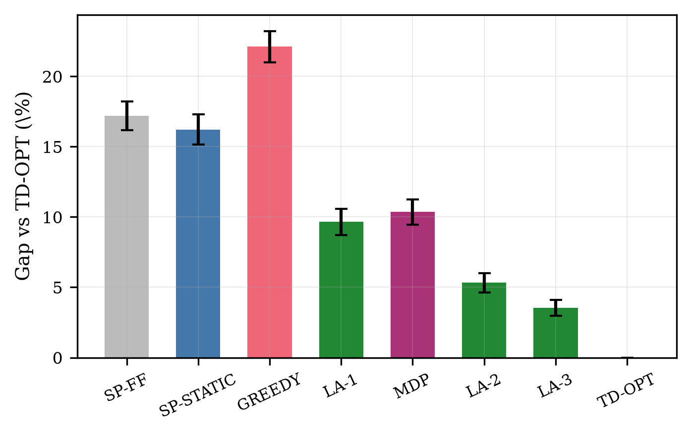

<h1 align="center">Signal-Aware Routing</h1>

<p align="center">
  <b>The Value of Traffic-Signal Phase Information for Route Choice:<br>How Much, How Far Ahead, and How Accurate</b>
</p>

<p align="center">
  Junbo Jacob Lian · Zheng Chen · Chaoyu Zhang · Xing Liu<br>
  <i>Submitted to Transportation Research Part C: Emerging Technologies, 2026</i><br>
  Preprint: <a href="https://papers.ssrn.com/sol3/papers.cfm?abstract_id=7368578">SSRN abstract 7368578</a>
</p>

<p align="center">
  <a href="https://papers.ssrn.com/sol3/papers.cfm?abstract_id=7368578"></a>
  <a href="https://github.com/junbolian/signal-aware-routing/releases/tag/v1.0-trc"></a>
  <a href="LICENSE"></a>
  
  
</p>

---

Code, network files, and simulation outputs for the paper ([preprint on SSRN](https://papers.ssrn.com/sol3/papers.cfm?abstract_id=7368578)). The paper measures what realized signal phase information is worth to a router facing fixed-time signals: how the value depends on the number of intersections ahead whose phases are known, on the accuracy of that knowledge, and on the decision rule.

- **Analytical part.** A movement-expanded grid network with per-movement waits and uncontrolled right turns.
- **Microscopic part.** The same networks and signal plans in SUMO, with background traffic, two lane layouts, and queue-aware benchmark planners.

Release `v1.0-trc` is the version that accompanies the submission. The SUMO results of the paper are the v2 sample of record in [`results_v2/`](results_v2/). Results of earlier experiment rounds are in the Git history at tag `pre-v2`.

<p align="center">
  
  <br><sub>The information ladder on the base grid: paired gap to TD-OPT for every method.</sub>
</p>

## Contents

- [Quick start](#quick-start)
- [Environment](#environment)
- [Repository layout](#repository-layout)
- [Paper elements and the commands that produce them](#paper-elements-and-the-commands-that-produce-them)
- [SUMO sample of record](#sumo-sample-of-record)
- [Citation](#citation)
- [License](#license)

## Quick start

```bash
git clone https://github.com/junbolian/signal-aware-routing.git
cd signal-aware-routing
git checkout v1.0-trc
pip install -r requirements.txt

python make_figures.py                          # Figures 2 to 5
python build_tables_v2.py results_v2            # Tables 4 to 7 and C.3
python make_figures_v3.py results_v2 figures    # Figures 6 and 7
```

## Environment

| Component | Version |
|---|---|
| Python | 3.11 (CPython), `pip install -r requirements.txt` |
| Eclipse SUMO | 1.27.1, installed through the `eclipse-sumo`, `sumolib`, and `traci` wheels in `requirements.txt`; the build used for the paper is recorded in [`results_v2/BUILD.txt`](results_v2/BUILD.txt) |
| Analytical experiments | the standard library, `numpy`, `scipy`, and `matplotlib` only |

> [!NOTE]
> Multi-vehicle SUMO runs are not bit-identical across simulator builds and platforms. Every SUMO number in the paper therefore comes from one build on one machine (Windows 11, SUMO 1.27.1), and a paired comparison should always use runs of all planners from the same build.

## Repository layout

**Analytical model and grid study**

| File | Purpose |
|---|---|
| `signal_routing.py` | Grid model: fixed-time four-phase signals, right turn on red, movement-expanded time-dependent label setting (TD-OPT), SP-FF, SP-STATIC and GREEDY, scenario ablations |
| `lookahead.py` | Rolling LA-k and the static value function |
| `extend_lookahead.py` | LA-k for k = 1..5 under countdown error |
| `lak_monotonicity.py` | Instance-level comparison of adjacent lookahead depths |
| `mdp_policy.py` | Optimal policy under unknown offsets (monotone action set) |
| `sweep_hetero.py` | GREEDY against SP-STATIC across link heterogeneity |
| `ladder_verify.py` | Monte Carlo check of the ladder law |
| `gini_verify.py` | Monte Carlo check of the ladder law across distributions |
| `gini_grid.py` | Full-grid slopes against the Gini mean difference |
| `pernet_slopes.py` | Per-network slope statistics |
| `p4_diagnostic.py` | Coupling bound on the accuracy experiments |
| `p4_hazard.py` | First-mismatch probability on the accuracy experiments |
| `check_uniform.py` | Arrival-phase uniformity check |
| `clustered_intervals.py` | Network-clustered intervals of the grid study |
| `make_appendix_tables.py` | Rows of Tables C.1 and C.2 |
| `make_figures.py` | Figures 2 to 5 (PNG) |

**Microscopic simulation (SUMO)**

| File | Purpose |
|---|---|
| `sumo_runner.py` | SUMO experiments (all planners, decision point, network index) |
| `queue_model.py` | Queue-aware planners SP-STATIC-Q, MDP-Q, TD-OPT-Q |
| `queue_kernel.py` | Empirical transition kernel of the count ahead, cross-fitted by network fold |
| `calibrate_discharge.py` | Discharge law of standing queues |
| `make_channelized_net.py` | Channelized four-lane grid `grid8_rt.net.xml` |
| `sumo_aggregate_q.py` | Analytical predictions for the SUMO networks (used by `aggregate_v2.py`) |
| `run_v2.py` | Resumable driver of the v2 sample |
| `aggregate_v2.py` | `results_v2/summary_v2.json` and `results_v2/tables_v2.txt` |
| `build_tables_v2.py` | Rows of Tables 4 to 7 and C.3 |
| `make_figures_v3.py` | Figures 6 and 7 (PDF) |

**Networks, data, and figures**

| Path | Contents |
|---|---|
| `grid8.net.xml` | Shared-lane 8 x 8 SUMO grid |
| `grid8_rt.net.xml` | Channelized 8 x 8 SUMO grid |
| `raw_results.csv` | Per-instance results of the grid study |
| `summary.csv` | Aggregated grid-study results |
| [`results_v2/`](results_v2/) | SUMO sample of record (see [`results_v2/README.md`](results_v2/README.md)) |
| `figures/` | Figures produced by the scripts; `figures/paper/` holds Figures 1 to 7 as typeset |

## Paper elements and the commands that produce them

Run every command from the repository root.

| Paper element | Command | Output |
|---|---|---|
| Table 2 (base scenario), Table 3 (ablations) | `python signal_routing.py` | `raw_results.csv`, `summary.csv` |
| Table 1 (rolling LA-k under countdown error) | `python extend_lookahead.py` | printed table |
| Network-clustered intervals of Tables 1 to 3 | `python clustered_intervals.py` | `clustered_intervals.json`, `clustered_intervals.txt` |
| Optimal policy under unknown offsets (Section 3) | `python mdp_policy.py` | printed values |
| Ladder law (Section 3) | `python ladder_verify.py`, `python gini_verify.py` | printed checks |
| Table C.1, Figure 2(a) | `python gini_grid.py`, `python pernet_slopes.py`, then `python make_appendix_tables.py` | `gini_grid_results.csv`, `gini_family_slopes.json`, `uniform_slope_pernet.json` |
| Table C.2 | `python p4_diagnostic.py`, `python p4_hazard.py`, then `python make_appendix_tables.py` | `p4_diag.json`, `p4_hazard.json` |
| Figures 2 to 5 | `python make_figures.py` | `figures/*.png` |
| SUMO sample (Section 4.2) | see [below](#sumo-sample-of-record) | `results_v2/<layout>_d<decide>/` |
| Tables 4 to 7 and C.3 | `python aggregate_v2.py`, then `python build_tables_v2.py results_v2` | `results_v2/summary_v2.json`, printed rows |
| Figures 6 and 7 | `python make_figures_v3.py results_v2 figures` | `figures/fig6_sumo_v2.pdf`, `figures/fig7_depth_v2.pdf` |

> [!TIP]
> `signal_routing.py`, `extend_lookahead.py`, and `mdp_policy.py` also write draft figures into `figures/`, and `signal_routing.py` writes its own version of `figures/fig2_voi.png`. Run `python make_figures.py` after them to restore Figures 2 to 5 as they appear in the paper.

Figure 1 is a schematic of the model and has no data source.

## SUMO sample of record

### Networks

The shared-lane grid was built with

```bash
netgenerate --grid --grid.number 8 --grid.length 500 --grid.attach-length 500 --default.lanenumber 2 --default.speed 8.33 --default-junction-type traffic_light --no-turnarounds -o grid8.net.xml
```

and the channelized grid with `python make_channelized_net.py`.

### Design

| | |
|---|---|
| Networks | ten (`SR_NETSEED=0..9`, offsets drawn with `random.Random(1000 + j)`) |
| Background seeds | 11 to 14, four departures per seed |
| Trip | one corner-to-corner trip |
| Demand | the empty network and insertion probabilities 1/100, 1/50, 1/25, 1/15, and 1/10 per corridor entry per second |
| Inference | every interval in the paper is a t interval over the ten network means |

### Discharge calibration

`python calibrate_discharge.py 15,10 11,12 900` fits the saturation headway of standing queues on the background traffic of network 0 at demand 1/15 and 1/10 (set `SR_NET=grid8_rt.net.xml` for the channelized grid). The fitted values used by the sample are in `results_v2/<layout>_d<decide>/discharge_calibration.json`.

### Runs

The driver skips every cell whose result file exists, so it can be stopped and restarted.

```bash
python run_v2.py --layout shared      --decide 45  --jobs 8
python run_v2.py --layout channelized --decide 45  --jobs 8
python run_v2.py --layout shared      --decide 100 --jobs 2
python run_v2.py --layout channelized --decide 100 --jobs 2
python aggregate_v2.py
```

`run_v2.py` sets `SR_NET`, `SR_RESULTS`, `SR_DECIDE`, and `SR_NETSEED` for each run and calls `queue_kernel.py` once the queue-ignorant runs of a demand level are complete on all ten networks. The kernel used on a network is estimated from the other network fold (even against odd networks). A single run can also be started directly, for example

```bash
SR_NETSEED=0 SR_RESULTS=results_v2/shared_d45 python sumo_runner.py dem LA1 11 15
```

which writes `results_v2/shared_d45/dem15_LA1_n0_11.json` with the four travel times of seed 11 at demand 1/15. In PowerShell, set the variables with `$env:SR_NETSEED="0"` and so on.

The complete run was 3,802 SUMO runs and about 75 core-hours.

## Citation

If you use this code or data, please cite the paper:

```bibtex
@unpublished{lian2026signal,
  author = {Lian, Junbo Jacob and Chen, Zheng and Zhang, Chaoyu and Liu, Xing},
  title  = {The Value of Traffic-Signal Phase Information for Route Choice: How Much, How Far Ahead, and How Accurate},
  note   = {Submitted to Transportation Research Part C: Emerging Technologies},
  year   = {2026},
  url    = {https://papers.ssrn.com/sol3/papers.cfm?abstract_id=7368578}
}
```

GitHub's "Cite this repository" button reads the same metadata from [`CITATION.cff`](CITATION.cff).

## License

Released under the MIT License. See [`LICENSE`](LICENSE).
